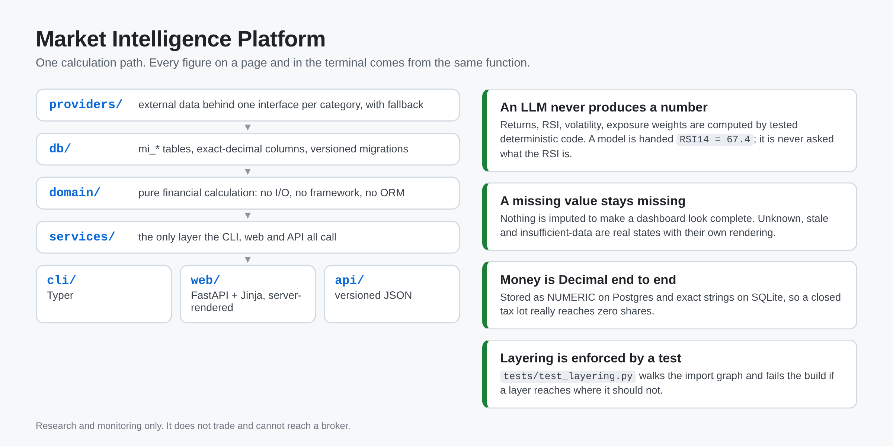

# Market Intelligence Platform

Portfolio intelligence, market monitoring and research. It gathers,
normalises, calculates and explains financial information so a decision can
be made with it.

**It does not trade.** Nothing here places an order, connects to a broker,
copies a trade, or acts on a conclusion it reaches. Execution is a separate
system that this one neither depends on nor can reach.



## Disclaimer

This project is for educational and research purposes only. It is not
investment advice, and nothing in it places orders or recommends buying or
selling anything. Figures can be wrong, delayed or missing; verify anything
that matters against your broker and the primary sources. Use it at your own
risk.

---

## What it is for

> Make it difficult to be surprised by something you could reasonably have
> known.

and, secondarily:

> Turn an overwhelming amount of financial information into a small number of
> trustworthy, prioritised, explainable insights.

The question the whole platform exists to answer, at any moment:

> What changed, why does it matter to me, how confident are we, and what
> deserves my attention now?

---

## The rule that shapes everything

**An LLM never produces a number.**

Portfolio value, average cost, realised and unrealised P&L, total return,
RSI, moving averages, MACD, ATR, beta, Sharpe, Sortino, drawdown,
correlation, valuation ratios, exposure weights — every one of these is
computed by deterministic code in `akmarkets.domain`, tested against
hand-computed references, and handed to a model as an input if a model is
involved at all.

The model sees `RSI14 = 67.4`. It is never asked what the RSI is.

The second rule follows from it: **a missing value stays missing.** Nothing
is imputed to make a dashboard look complete. Unknown, unavailable, stale
and insufficient-data are real states with their own rendering, and a
component with no recent information reports `unknown`, never `healthy`.

---

## Quick start

```bash
uv sync
uv run ak-markets db migrate     # creates the local SQLite schema
uv run ak-markets serve          # http://127.0.0.1:8770
```

Set `AKM_EDGAR_CONTACT` to an address you control before fetching fundamentals
(SEC EDGAR requires a contactable User-Agent; the default is the placeholder
`you@example.com`).

No cloud credentials are needed. Absent a `AKM_DATABASE_URL`, state lives in
a SQLite file under `var/`, and every data source the platform uses by
default is free and needs no account.

```bash
uv run ak-markets config         # resolved settings, no secrets
uv run ak-markets status         # database reachable? schema current?
uv run ak-markets db status      # migrations on disk vs applied
uv run ak-markets secrets status # which optional provider keys exist
```

---

## Architecture in one screen

```
providers/   external data behind one interface per category, with fallback
     │
db/          mi_* tables, exact-decimal columns, versioned migrations
     │
domain/      pure financial calculation — no I/O, no framework, no ORM
     │
services/    the only layer the CLI, web and API all call
     │
     ├── cli/   Typer
     ├── web/   FastAPI + Jinja, server-rendered
     └── api/   versioned JSON, for the future iOS client
```

There is no web-only calculation and no CLI-only calculation. A figure shown
on a page and the same figure printed by a command come from one function,
so they cannot disagree. `tests/test_layering.py` walks the import graph and
fails the build if a layer reaches somewhere it should not — a layering rule
that is only documented is a layering rule that stops being true.

Full detail in **[ARCHITECTURE.md](ARCHITECTURE.md)**. Deployment in
**[DEPLOY.md](DEPLOY.md)**.

---

## Money is `Decimal`, everywhere

`float` cannot represent `0.1`. A portfolio value is a sum of hundreds of
products of a price and a quantity, and those errors accumulate into a
figure that gets compared against a broker statement to the cent. Worse, the
tax-lot engine decides whether a lot is *closed* by comparing a remaining
quantity to zero, and a residue of `1e-17` shares turns a closed position
into one that never disappears.

So every amount and every share count is a `Decimal` end to end. Postgres
stores them as `NUMERIC`; SQLite has no decimal type, so
`akmarkets.db.types` stores the string form and parses it back, which is
exact on both backends and identical in Python.

---

## Data sources

Everything below is free, and **nothing here needs an API key or an
account**. That is not a coincidence — where the obvious source wanted a
registration, the primary source it redistributes was used instead.

| Category | Source | Key |
|---|---|---|
| Daily OHLCV, delayed quotes | Nasdaq → Yahoo | none |
| Fundamentals, filings | SEC EDGAR (XBRL `companyfacts`, submissions) | none |
| Earnings calendar, estimates | Nasdaq | none |
| Macro rates | US Treasury (par yield curve, `fiscaldata`) | none |
| News | Google News RSS | none |
| Sentiment, deduplication, clustering | local models (`--extra ml`) | optional |

Two sources named in earlier drafts are gone, both on measurement rather
than preference:

- **Stooq** now answers with a JavaScript proof-of-work challenge instead
  of data. Working around an access control the operator put up is not a
  data-sourcing strategy, so it was replaced rather than defeated.
- **FRED and Finnhub** wanted accounts. Their keyless equivalents are the
  primary sources they redistribute — US Treasury for rates, Nasdaq for the
  earnings calendar — which is strictly better: one hop closer to the
  issuer, and no credential to expire, leak or rotate.

No provider is load-bearing. Each category declares a Protocol, adapters
implement it, and a fallback chain tries them in configured order. Every
value carries its source, effective time and retrieval time. Two providers
disagreeing materially is recorded as a data-quality finding, not silently
resolved by whichever answered first.

---

## Optional extras

```bash
uv sync --extra postgres   # Supabase/Postgres instead of local SQLite
uv sync --extra ml         # local embeddings + finance sentiment
uv sync --extra ai         # Tier 2/3 LLM synthesis
```

The base install has none of them, and the platform is fully usable without
any. AI is off by default and stays off until switched on explicitly, with a
hard daily cost ceiling.

---

## Tests

```bash
uv run pytest
uv run ruff check src tests
uv run mypy
```

---

**Not financial advice. Nothing here is a recommendation to buy or sell
anything.**

## License

MIT. See [LICENSE](LICENSE).
